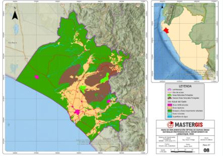

## 

## Resumen

**Objetivo:** Detallar cada fase de la metodología para mitigar riesgos de seguridad.

El artículo presenta un sistema para evaluar el tráfico y la seguridad
de la red en una organización, basado en la metodología de seguridad
informática de Benson (2001).

**Metodología y Resultados:** Se analizan los logs generados por
Suricata-IDS (Sistema de Detección de Intrusos). El sistema genera:

1.  Cuadros resumen con el tráfico de la red durante un periodo
    determinado.

<!-- -->

2.  Un resumen de los ataques detectados, diferenciando los que fueron
    procesados y los que están en cuarentena pendientes de análisis.

    **Conclusión:** Los autores concluyen que es de gran utilidad
    almacenar el tráfico generado para evaluar riesgos cada vez que se
    descubre una nueva vulnerabilidad. Esto permite establecer controles
    de seguridad, reducir la superficie de ataque y de exposición, y
    presentar los resultados de forma comprensible al usuario para
    facilitar la toma de decisiones sobre políticas de seguridad.

    *Palabras clave:* Sistema de detección de intrusos, Control de
    seguridad, Logs, Superficie de ataque.

    ## Abstract

    The article presents a communication management system to assess
    security risks, based on Benson's (2001) computer security
    methodology.Objective: To detail each phase of the methodology to
    mitigate security risks.

    **Methodology and Results:** The analysis is performed on logs
    generated by Suricata-IDS (Intrusion Detection System). The system
    generates:

    1.  Summary tables with the traffic generated in the organization
        over a given period.

    2.  A summary of attacks, differentiating between those that were
        processed and those that are in quarantine awaiting analysis.

        **Conclusion:** The authors conclude that storing generated
        traffic is highly helpful to assess security risks whenever a
        new security flaw is discovered. This allows for establishing
        security controls, reducing the attack surface and exposure, and
        presenting results in an understandable way to help users make
        decisions regarding implemented security policies.Keywords:
        Intrusion detection system, Security control, Logs, Attack
        Surface.

        ## References:

<https://rus.ucf.edu.cu/index.php/rus/article/view/2690/2646>
