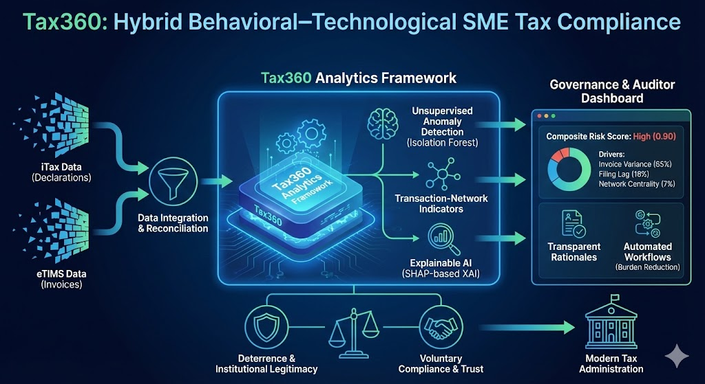

## {width="748"}

## Resumen

**Objetivo:** Desarrollar y evaluar un algoritmo automatizado para reducir el tiempo de análisis de Comprobantes Fiscales Digitales por Internet (CFDI) aplicado a PYMES.

**Contexto y problema:**

-   En México el Art. 29 del CFF obliga a emitir CFDI desde 2009, lo que disparó el volumen de facturas electrónicas.

-   El 72% de los casos ante el Tribunal Federal de Justicia Administrativa en la última década fueron por registro incorrecto de CFDI.

El análisis manual de montos, impuestos y deducibilidad es una tarea rutinaria, lenta y propensa a errores. Esto retrasa la toma de decisiones y afecta la competitividad de las PYMES, que dependen mucho de intervención humana.

**Metodología - Enfoque mixto y experimental:**

1.Fase cualitativa: Se analizó el proceso manual de revisión de un CFDI (evaluar deducibilidad y verificar montos) y se creó un diagrama de flujo.

2.Implementación del algoritmo secuencial:

-   El algoritmo:Lee automáticamente el XML/PDF del CFDI
-   Extrae datos relevantes (nombre emisor, RFC, monto, impuestos)
-   Determina automáticamente si es deducible según la legislación fiscal mexicana (Art. 29-A CFF)
-   Calcula IVA y total, y exporta todo a un archivo Excel externo.

3\. Fase experimental comparativa:

-   Participantes: 170 estudiantes de Ingeniería Financiera seleccionados aleatoriamente (muestra representativa con 95% de confianza).

-   Equipo: 20 estaciones con Intel i7-1165G7, 16GB RAM.

-   Procedimiento manual: Registrar datos del CFDI en Excel 2016.

-   Procedimiento automatizado: Usar el algoritmo desarrollado en las mismas condiciones de hardware.

-   Se midió el tiempo de cada ejecución: 170 mediciones.

**Resultados y Análisis Estadístico:**

-   Análisis en RStudio con prueba t pareada y d de Cohen:

-   Reducción de tiempo promedio: 220.14 segundos más rápido el algoritmo.

-   Intervalo de confianza 95%: 206.90 a 233.30 segundos.

-   p-valor \< 2.2 x 10⁻¹⁶: diferencia altamente significativa.

-   Tamaño del efecto d de Cohen = 3.77: efecto muy grande (no solo es estadísticamente significativo, sino prácticamente relevante). IC 95%: 3.13 a 4.42.

-   Boxplot: Mediana algoritmo = 45.7 seg (Q1-Q3: 44.4-47.2, min-max: 43-49 seg) vs. Manual = 266 seg (Q1-Q3: 202-322, min-max: 71-489 seg).

-   Efectividad del algoritmo: 88% de acierto en determinar la deducibilidad fiscal.

-   Índice de ganancia de información: Si está por encima de 70% el sistema está aprendiendo bien; si está debajo, necesita más volumen y calidad de datos.

**Discusión**

El algoritmo debe adaptarse a las particularidades internas de cada organización: 1) para personas morales, basarse en el objeto social, 2) para personas físicas, en el historial de operaciones. Esto mejora el entrenamiento del sistema. Integrar este tipo de algoritmos libera recursos humanos para tareas estratégicas, mejora la productividad y es clave para la educación contable y la competitividad de las PYMES. La automatización reduce costos de personal y permite reasignar recursos.

**Conclusiones**

El algoritmo demostró una ventaja promedio de 220.14 segundos sobre la captura manual con efecto muy grande. La automatización no solo acelera el procesamiento, sino que mejora significativamente la eficiencia operativa, optimiza procesos, mejora la productividad y apoya la toma de decisiones contables y organizacionales. Es fundamental adaptarlo a cada empresa y evaluar continuamente su ganancia de información. La integración de IA y automatización en contabilidad y auditoría fortalece la toma de decisiones y fomenta entornos más productivos. Contribuye a la transformación digital en el ámbito contable y financiero.

**Palabras clave:** *CFDI*, *productividad de procesos*, *contabilidad robótica*, *algoritmo secuencial*.

## Design and Implementation of an Automated CFDI Analysis Algorithm for Accounting and Tax Optimization in SMEs

**Objective:** Develop and evaluate an algorithm to reduce time required for analysis of Digital Tax Receipts (CFDI) for SMEs.

**Abstract**

Mandatory CFDI issuance in Mexico since 2009 created huge volume. 72% of cases before TFJA in last decade were due to incorrect CFDI recording. Manual analysis is slow, error-prone, and affects SME competitiveness.

**Methodology: Mixed and experimental approach:**

-   Qualitative phase: Manual process analysis and flowchart design.

-   Algorithm implementation: Auto-reads CFDI, extracts issuer, RFC, amount, taxes, auto-determines deductibility per Mexican tax law, calculates VAT/total, exports to Excel.

Experimental phase: 170 Financial Engineering students, 20 identical PCs (i7-1165G7, 16GB RAM), timed manual vs. automated execution. 170 measurements. Analysis in RStudio.

**Results:**

-   Average time saving: 220.14 seconds faster with algorithm (95% CI: 206.90-233.30s)

-   p \< 2.2e-16, highly significant paired t-testCohen's d = 3.77, very large effect size (95% CI: 3.13-4.42)

-   Median time: Algorithm 45.7s (44.4-47.2 IQR) vs Manual 266s (202-322 IQR)

-   88% effectiveness in determining CFDI deductibility

Information gain index \>70% indicates adequate learning.

**Conclusion**

The algorithm significantly speeds up processing and enhances operational efficiency. It frees human resources for strategic tasks, is key for accounting education and SMEs, and should be adapted to each organization's corporate purpose (legal entities) or operation history (individuals). Integration of AI and automation strengthens decision-making and drives digital transformation in accounting/finance.

## References

#### [*https://ijcopi.org/ojs/article/view/1214/500*](https://ijcopi.org/ojs/article/view/1214/500){.uri}

## 

#### 
