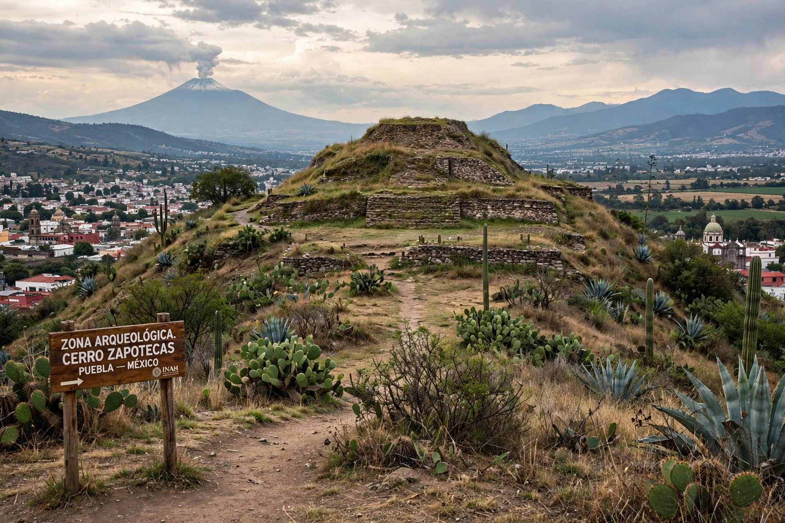

## 

## Resumen

**Objetivo:** Analizar el sistema de Áreas Naturales Protegidas (ANP) en México, considerando su superficie, categorías y administración federal y estatal, como estrategia de conservación a largo plazo.

El Cerro Zapotecas es un Área Natural Protegida (ANP) que se encuentra a dos kilómetros de la Universidad Politécnica de Puebla (UPPue), por tanto, una importante presencia de la flora y la fauna endémica del ANP se puede encontrar en el campus universitario. El presente trabajo tiene por objetivos describir la importancia en torno a la conservación de este hábitat, señalar las problemáticas que presenta, así como motivar la concientización y participación de la población universitaria de UPPue en la conservación de la flora y fauna local.

\- Las ANP son consideradas la mejor estrategia de conservación de recursos naturales a largo plazo. En México existe un área total destinada a conservación de más de 25,3947 km² distribuidas en diferentes categorías \[CONANP 2015\]. Las de mayor extensión pertenecen al Sistema Nacional de Áreas Naturales Protegidas (SINAP) administradas por Gobierno Federal. Las ANP estatales responsabilidad de gobiernos estatales.

\- Criterios para establecimiento ANP: distribución especies flora y fauna en categoría de riesgo, endémicas y de importancia para provisión servicios ambientales: captura de CO₂, captación y retención de agua y belleza escénica.

\- ***Cerro Zapotecas:***localizado en municipio San Pedro Cholula, Estado de Puebla, decretado como ANP en ***2006*** por tratarse de un ecosistema urbano con relictos de ***bosque templado***. Superficie ***536.43** hectáreas*, altitud ***2,300 msnm*****.**

\- Contribuye a conservación recursos forestales municipio San Pedro Cholula y gran importancia cultural para 7 comunidades colindantes: San Cristóbal Tepontla, San Francisco Coapa, San Gregorio Zacapechpan, San Juan Tlautla, San Diego Cuachayotla, San Sebastián Tepalcatepec, San Agustín Calvario.

\- Beneficios alcanzan población de ***más de 120 mil habitantes*** solo en San Pedro Cholula: mantenimiento calidad gaseosa atmósfera que permite regular clima; mejoramiento calidad agua; control ciclos hidrológicos incluyendo reducción inundaciones y sequías, generación y conservación suelos fértiles; y presencia, conservación y mantenimiento de importante *"librería genética"*. En cerro se encuentra número importante especies flora y fauna endémica, incluye especies protegidas.

***Desarrollo y Problemáticas***

\- Es clave en movimientos de migración y dispersión poblaciones especies flora y fauna silvestres. Este proceso se logra a través de *conectividad ecológica del paisaje*, fundamental para conservación biodiversidad.

\- Sin embargo, dinámica cambio de uso de suelo a través de deforestación, actividades agrícolas y construcción viviendas o infraestructura telecomunicaciones, tanto dentro como fuera del Cerro, produce efecto ***fragmentación del hábitat*****.**

\- **Impactos:** contaminación por agroquímicos, construcción infraestructura, tráfico vehículos, emisiones al aire, y riesgo incendios provocados por residuos sólidos liberados por personas. Estos factores estrés provocan alteraciones en abundancia y distribución fauna silvestre. En aves, ruido producido por vehículos y maquinaria para construcción es uno de factores que más influye en disminución densidad población.

-   ***Teoría de biogeografía de islas**:* sitios conservación aislados, fragmentados y sin conectividad ecológica tienen mayor probabilidad consecuencias para pérdida biodiversidad \[Laurance 2000, Henle et al 2004\].

***Conclusiones***

-   Grado de aislamiento del Cerro Zapotecas va en aumento en últimos años, debido a deforestación, intensificación actividad agrícola y crecimiento mancha urbana. - Si continúa tendencia en dinámica cambios ambiente, se producirá efecto aislamiento total para reserva que impedirá movimiento y colonización individuos, contribuyendo a *extinción local de poblaciones por falta flujo genético debido aumento consanguinidad*. - Comunidad universitaria UPPue puede favorecer conservación especies a través de áreas verdes campus, proyectos investigación y participación estudiantil y ciudadana, de tal forma que su intervención puede ser elemento estratégico en preservación ANP.

*Referencias:*

<https://www.researchgate.net/figure/Figura-1-Uso-de-suelo-destinado-a-la-agricultura-dentro-del-ANP-Cerro-Zapotecas_fig1_309312841>

------------------------------------------------------------------------

## Abstract

***Cerro Zapotecas and its ecological importance***

The Cerro Zapotec is a Protected Natural Area (PNA) that is two kilometers from the Universidad Politécnica de Puebla (UPPue), therefore, a significant presence of endemic flora and fauna of the PNA can be found on campus. The objective of this paper is to describe the importance regarding the conservation of this habitat, noting the problems that presents and encourage awareness and participation of the university population UPPue in the conservation of flora and fauna.

***Keywords:*** conservation, habitat, fragmentation, Natural protected area.

***Development***

\- Key for migration and dispersal movements of wildlife populations through ***ecological landscape connectivity***, fundamental for biodiversity conservation.

\- However land-use change dynamics: deforestation, agricultural activities and housing construction / telecom infrastructure inside and outside cause ***habitat fragmentation*****.** Inside PNA, *159.7 ha* destined to agriculture (Figure 1, INEGI source) plus two telecom antennas. Impacts: agrochemical pollution, infrastructure construction, vehicle traffic, air emissions, fire risk from solid waste. Stress factors alter abundance and distribution of wildlife. In birds, noise from vehicles/machinery construction most influences density decrease.

\- ***Island biogeography theory**:* isolated, fragmented conservation sites without ecological connectivity have higher probability of biodiversity loss consequences. - *Figure 2:* Geographic location PNA. Important for ecological connectivity *between two federal PNAs National Park category: La Malinche and Izta-Popo*. These two National Parks are 50 km apart at closest point. But ecological connectivity between them limited by urban and crop zones. Only viable point for interconnection due to location, size and conservation degree is *pine-oak forest* inside Cerro Zapotecas. - *Role of UPPue:* Located only 2 km from Cerro, green areas of campus have become receptacle of endemic flora and fauna, participating in conservation of vast number species.

***Conclusions***

-   Isolation degree of Cerro Zapotecas increasing in recent years due to deforestation, agricultural activity intensification and urban sprawl growth.

\- If trend continues, total isolation effect for reserve will impede movement and colonization of individuals, contributing to *local extinction of populations due to lack of gene flow from increased inbreeding*.

\- UPPue university community can favor species conservation through campus green areas, research projects and student/citizen participation, so its intervention can be strategic element in PNA preservation.

## References

<https://www.researchgate.net/figure/Figura-1-Uso-de-suelo-destinado-a-la-agricultura-dentro-del-ANP-Cerro-Zapotecas_fig1_309312841>
